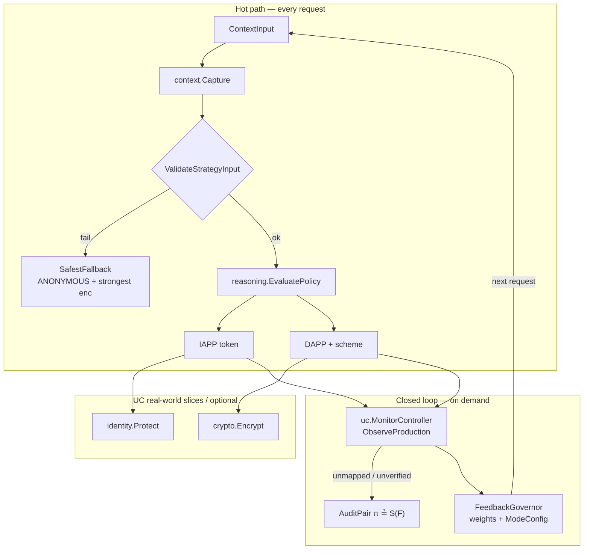

# ACFP Architecture

This document describes the architecture of the `adaptive/` module as implemented in code.

## Role in ACFP

`adaptive/` is the **decision and UC-verification core**. Upstream services (`identity-policy`, `data-policy`) call it to obtain IAPP/DAPP strategies. It does **not** own Fabric chaincode or production encryption backends; those live in sibling modules.

```
Workflow event
    → Context-Awareness (pkg/context)
    → Logical Reasoning (pkg/reasoning)  → {IAPP, DAPP, enc scheme}
    → Identity Protect  (pkg/identity)  → handle h
    → Encryption stub   (pkg/crypto)    → ciphertext (UC slice)
    → optional Monitor / UC audit       (pkg/uc)
```

Production path typically stops after reasoning: identity generation and real crypto run in `identity-policy` / `data-policy`. The `pkg/identity` and `pkg/crypto` packages here are the **executable UC real-world slices** used by \pi_{\mathrm{adaptive}} and verification.

## Core mapping


\text{Policy} = (f_{\mathrm{id}}, f_{\mathrm{enc}})(\mathcal{C})
\rightarrow \mu,\sigma,\quad
\mathcal{C}=(s,m,r,q,d,\ell,\mathit{cfg})


| Symbol       | Field              | Source type                   | Example values                                          |
| ------------ | ------------------ | ----------------------------- | ------------------------------------------------------- |
| s            | phase              | `ContextInput.Phase`          | `SUBMISSION`, `REVIEW`, `PUBLICATION`                   |
| m            | role               | `ContextInput.Role`           | `AUTHOR`, `EDITOR`, `REVIEWER`                          |
| r            | review mode        | `ContextInput.ReviewMode`     | `DOUBLE_BLIND`, `SINGLE_BLIND`, `OPEN`, `*`             |
| q            | request content    | `ContextInput.RequestContent` | `SUBMIT`, `SUBMIT_REVIEW_REPORT`, …                     |
| d            | data type          | `ContextInput.DataType`       | `MANUSCRIPT`, `MESSAGE`, `FINAL_RECOMMENDATION`, …      |
| \ell         | security level     | `ContextInput.SecurityLevel`  | `0`–`3`                                                 |
| \mathit{cfg} | mode-config digest | `ContextInput.ModeConfig`     | floor raisers (`ForceAnonymous`, `MinSecurityLevel`, …) |


Rules live in `config/adaptive_rules.yaml` (catalog version `1.0`, must stay in sync with `reasoning.ConfigCatalogVersion` and `DefaultIdealSpec`).

## Component diagram




## Fail-closed behaviour

`context.ValidateStrategyInput` rejects mismatched phase/role or bad integrity MAC. On failure, `reasoning.SafestFallback` returns:

- IAPP = `ANONYMOUS`
- DAPP / level raised to strongest composition

`π.Invoke` then **aborts** business Protect/Encrypt (`ErrFailClosedAbort`) while still emitting a `PublicTrace` for audit.

## ModeConfig (protection floor)

`context.ModeConfig` may only **raise** the floor (never lower):


| Field              | Effect                        |
| ------------------ | ----------------------------- |
| `ForceAnonymous`   | Force IAPP → `ANONYMOUS`      |
| `MinSecurityLevel` | Raise DAPP security level     |
| `AllowComposition` | Allow multi-algorithm cascade |
| `RequireSTE`       | Force `SIGN_THEN_ENCRYPT`     |


Applied by `reasoning.ApplyModeConfig` / `ApplyWeightGovernance*`. Governor writes the next request’s `cfg` via `MonitorController.PrepareInput`.

## Package map


| Package                  | Responsibility                                                                                   |
| ------------------------ | ------------------------------------------------------------------------------------------------ |
| `pkg/context`            | Capture \mathcal{C}, normalize tokens, validate strategy input, `ModeConfig`                     |
| `pkg/reasoning`          | YAML rules, `LogicalReasoningEngine`, `AdaptiveCoordinator`, weights, static-vs-adaptive fitness |
| `pkg/identity`           | \mathcal{F}*{\mathrm{id\text{-}protect}} / \mathcal{F}*{\mathrm{nym}} realisations               |
| `pkg/crypto`             | \mathcal{F}*{\mathrm{enc}} / \mathcal{F}*{\mathrm{SC}}: AES-GCM, CASCADE, STE                    |
| `pkg/uc`                 | \pi, \mathcal{F}, \mathcal{S}, composition, monitor, governor, E1–E11 suite                      |
| `cmd/uc_verify`          | UC verification CLI                                                                              |
| `cmd/adaptive_benchmark` | Adaptivity experiments (IAPP/DAPP/hot-update)                                                    |


See [MODULES.md](./MODULES.md) for file-level detail.