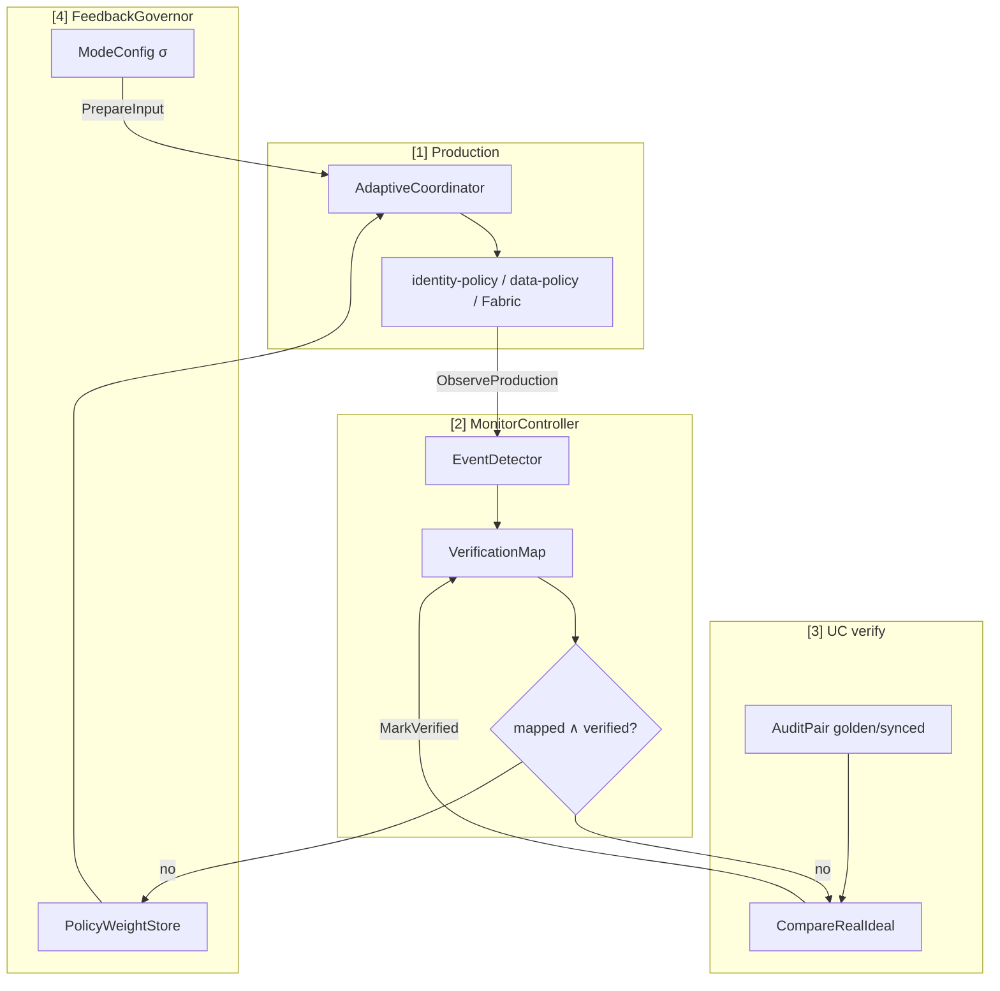
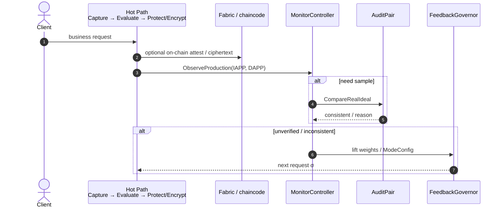

# Closed-Loop Control (Hot Path ⇄ Monitor ⇄ UC ⇄ Governor)

Code: `pkg/uc/monitor_controller.go`, `feedback_governor.go`, `audit_pair.go`, `verification_map.go`, `ideal_map.go`.

UC does **not** route every business request. The hot path produces authenticated \(\mathcal{C}\) and IAPP/DAPP; the monitor samples; the governor writes the **next** request’s `ModeConfig` / weights.

## Responsibility split

| Component | Owner | Duty |
|-----------|-------|------|
| `IdealSpec` | UC | Read-only `(IAPP,DAPP) → F_nym / F_SC` bindings |
| `VerificationMap` | Monitor | Spec reference + runtime `Verified` marks; sole writer of `MarkVerified` |
| `AuditPair` / Compare | UC | \(\pi\) ≟ \(S(\mathcal{F})\) on `PublicTrace` |
| `FeedbackGovernor` | Governance | Sync weights; optionally lift \(\sigma\) (`ModeConfig`) |

## Loop stages

```
[1] Production  → IAPP/DAPP from AdaptiveCoordinator
[2] Monitor     → ObserveProduction → VerificationMap.Status
       ├─ mapped ∧ verified → record only
       └─ else → dual trigger:
            [3] UC AuditPair.Compare (+ MarkVerified)
            [4] FeedbackGovernor (weights / ModeConfig) → next request
```



## Production integration

```go
mon := uc.NewMonitorController(/* journalThreshold */ 3)

// After hot-path strategy decision:
mon.ObserveProduction(uc.ProductionStrategy{
    SID: sid, IAPP: iapp, DAPP: dapp,
    Phase: phase, Role: role, ReviewMode: mode,
    DataType: dtype, Level: level,
})

// Before the next Evaluate*:
mon.PrepareInput(&nextInput) // injects EffectiveCfg into ContextInput.ModeConfig
```

Or via protocol helper: `Protocol.InvokeWithMonitor(req, mon)`.

### Online vs ideal comparison

When auditing a live decision, set `AdaptiveRequest.OnlineStrategy` so \(\pi\) pins the production IAPP/DAPP. Ideal \(\mathcal{F}\) **ignores** that pin and re-selects from \(\mathcal{C}\). Consistency therefore means: **online business strategy ≡ ideal strategy for the same \(\mathcal{C}\)**.

## Sequence (one closed-loop step)

```mermaid
sequenceDiagram
  autonumber
  participant Prod as Production
  participant Mon as MonitorController
  participant VMap as VerificationMap
  participant Pi as π (online pin)
  participant F as F / S (ideal reselect)
  participant Gov as FeedbackGovernor

  Prod->>Mon: ObserveProduction(IAPP, DAPP, C)
  Mon->>VMap: Status(mapped, verified)
  alt mapped ∧ verified
    Mon->>Mon: RecordOnly
  else miss
    par dual trigger
      Mon->>Gov: OnUnmappedStrategy / SyncWeightsFromMap
      Mon->>Pi: Compare(OnlineStrategy=production)
      Pi->>F: same C; F reselects
      Pi-->>Mon: T_π ≟ T_ideal
      Mon->>VMap: MarkVerified(ok)
    end
    Gov-->>Prod: weights + σ for next request
  end
```

## Hot-path business sequence (no UC internals)



## Spec ↔ hot-path config sync

Runtime Spec is **not** rewritten per request. Keep catalogs aligned:

1. `reasoning.ConfigCatalogVersion` == `RuleSet.Version` == `IdealSpec.Version` (`"1.0"`)
2. `CheckHotPathSpecSync(spec, rules)` — mutual vocabulary inclusion
3. After editing `adaptive_rules.yaml` / `DefaultRuleSet` / `DefaultIdealSpec`, bump version and run:

```bash
go test ./pkg/uc -run TestHotPathIdealSpecConfigSync
```

## Environment

| Variable | Effect |
|----------|--------|
| `ADAPTIVE_RULES_PATH` | Production coordinator YAML; golden \(\pi\) uses the same singleton |

Shared weights: `reasoning.SharedPolicyWeights()` — governor updates affect subsequent `Evaluate*` immediately.
