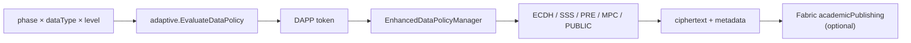

# Data Policy (Π_data / DAPP) Architecture

Module: `github.com/tap-thesis/privacy-protection-data`  
Role in ACFP: **execute** adaptive data-protection strategies (encryption / sharing / public) chosen for publishing workflow context.

Strategy *selection* comes from `adaptive` (DAPP tokens). This module *realizes* those tokens as concrete `EncryptionPolicy` implementations and optionally records results on Hyperledger Fabric.

## Position in ACFP



| Layer | Location | Duty |
|-------|----------|------|
| DAPP decision | `privacy-protection/adaptive` via `LoadCoordinatorFromEnv()` | \(f_{\mathrm{enc}}(s,d,\ell,\mathit{cfg})\rightarrow\) DAPP |
| Policy manager | `datapolicy/` (export) or `internal/data_policy/` (CLI) | Map DAPP → `EncryptionPolicy`; encrypt/decrypt |
| Crypto backends | `*EncryptionPolicy.go`, `pkg/crypto` (PRE helpers) | Algorithm execution |
| Chain client | `internal/blockchain` | Store policies / encrypted papers on chain |
| Perf harness | `caliper-workspace/` | Fabric Gateway TPS benchmarks |

## Dual package layout

| Path | Purpose |
|------|---------|
| `datapolicy/` | **Exported** package for other services; wired to adaptive DAPP (`GetEncryptionPolicyWithLevel` → `EvaluateDataPolicy`) |
| `internal/data_policy/` | Standalone CLIs/tests; static phase×type×level selectors (same algorithm set) |
| `pkg/types` | Shared enums: phase, data type, security level, chain DTOs |
| `pkg/crypto` | Proxy re-encryption primitives / server helpers |
| `cmd/data_manager` | Off-chain crypto latency & workflow benchmarks |
| `cmd/paper_manager` | Paper workflow against Fabric + local DB |
| `cmd/rubric_export` | Attack-surface / confidentiality rubric → LaTeX |
| `chaincode/` | README pointer only → canonical chaincode elsewhere |
| `caliper-workspace/` | Hyperledger Caliper configs and workloads |

Prefer importing `datapolicy` for new integrations so adaptive YAML (`ADAPTIVE_RULES_PATH`) drives selection.

## Selection algorithm (`datapolicy`)

`EnhancedDataPolicyManager.GetEncryptionPolicyWithLevel(phase, dataType, level)`:

1. If adaptive coordinator is available → `EvaluateDataPolicy(C)` → `policyFromDAPP(DAPPStrategy)`.
2. Else fall back to hardcoded `policySelectors[phase_dataType](level)`.
3. Else fall back to default `policies[phase_dataType]`.

DAPP → implementation map:

| DAPP token (`reasoning`) | Policy type string | Implementation |
|--------------------------|--------------------|----------------|
| `ECDH_HKDF` | `ECDH_HKDF` | `ECDHEncryptionPolicy` |
| `SSS` | `SSS` | `SSSEncryptionPolicy` |
| `PROXY_REENCRYPTION` | (PRE) | `ProxyReEncryptionPolicy` |
| `MPC` | `MPC` | `MPCEncryptionPolicy` |
| `PUBLIC` | `PUBLIC` | `PublicEncryptionPolicy` |

## Default phase × data × level matrix (static fallback)

| Phase | Data type | Level 0 | Level 1 | Level 2 | Level 3 |
|-------|-----------|---------|---------|---------|---------|
| SUBMISSION | MANUSCRIPT | — | ECDH | SSS | — |
| SUBMISSION | MESSAGE | — | ECDH | PRE | — |
| SUBMISSION | ENCRYPTION_KEY | — | PRE | — | — |
| REVIEW | MANUSCRIPT | — | ECDH | SSS | — |
| REVIEW | SUPPLEMENTARY_DATA | — | ECDH | PRE | — |
| REVIEW | MESSAGE | — | ECDH | PRE | — |
| REVIEW | FINAL_RECOMMENDATION | — | ECDH | PRE | MPC |
| REVIEW | ENCRYPTION_KEY | — | PRE | — | — |
| PUBLICATION | MANUSCRIPT | — | ECDH | SSS | — |
| PUBLICATION | MESSAGE | PUBLIC | — | — | — |
| PUBLICATION | ENCRYPTION_KEY | — | PRE | — | — |

Legacy `PAPER` keys remain for older callers (`SUBMISSION`→ECDH, `REVIEW`→SSS, `PUBLICATION`→PUBLIC).

## EncryptionPolicy contract

```go
type EncryptionPolicy interface {
    Encrypt(data []byte, participants []string) ([]byte, map[string][]byte, error)
    Decrypt(encryptedData []byte, metadata map[string][]byte, participantID string) ([]byte, error)
    GetPolicyType() string
}
```

Manager façade: `EncryptDataWithLevel` / `DecryptDataWithLevel`.  
Adaptive audit hook (export package): `EvaluateAdaptivePolicy(...)`.

## Types (`pkg/types`)

| Enum | Values |
|------|--------|
| `PublishingPhase` | `SUBMISSION`, `REVIEW`, `PUBLICATION` |
| `DataSecurityLevel` | `0` public … `3` strongest |
| `DataType` | `MANUSCRIPT`, `MESSAGE`, `ENCRYPTION_KEY`, `SUPPLEMENTARY_DATA`, `FINAL_RECOMMENDATION` |

Chain-facing structs (`Message`, `Transaction`, encrypted paper DTOs) use JSON tags aligned with chaincode `academicPublishing`.

## Fabric boundary

- Client: `internal/blockchain/academicPublishingClient.go` (Fabric Gateway).
- Chaincode ID: `academicPublishing` (sources under sibling `../chaincode/privacy-protection/`, not duplicated here).
- Typical on-chain ops exercised by Caliper / `encryption_chain` build: store/get data-protection policy, encrypted paper, re-encryption keys.

## Configuration

| Item | Notes |
|------|-------|
| `config.yaml` / `config/config.yaml` | Local Fabric CCP / wallet paths |
| `ADAPTIVE_RULES_PATH` | Shared with adaptive; affects exported `datapolicy` manager |
| Go | **1.21+**; `replace privacy-protection/adaptive => ../adaptive` |

## Related docs

- [EXPERIMENTS.md](./EXPERIMENTS.md) — security tests, rubric export, benchmarks, Caliper
- [../caliper-workspace/README.md](../caliper-workspace/README.md) — performance harness detail
- [../../adaptive/docs/ARCHITECTURE.md](../../adaptive/docs/ARCHITECTURE.md) — upstream ACFP decision engine
