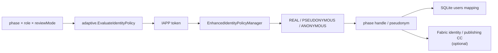
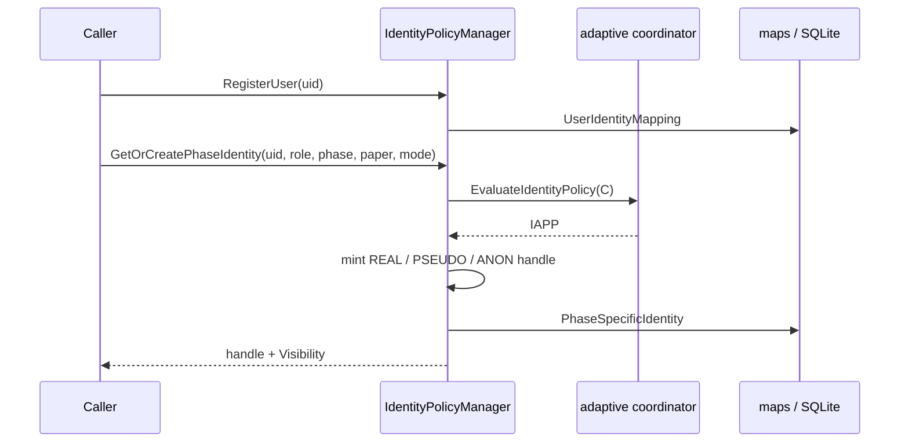

# Identity Policy (Π_id / IAPP) Architecture

Module: `github.com/tap-thesis/privacy-protection-identity`  
Role in ACFP: **execute** adaptive identity-visibility strategies (real / pseudonymous / anonymous) for publishing workflow participants.

Strategy *selection* comes from `adaptive` (IAPP tokens). This module *realizes* those tokens as phase-scoped on-chain handles, maintains off-chain↔on-chain mappings, and optionally commits identity records via Hyperledger Fabric.

## Position in ACFP

| Layer | Location | Duty |
|-------|----------|------|
| IAPP decision | `privacy-protection/adaptive` via `LoadCoordinatorFromEnv()` | \(f_{\mathrm{id}}(s,m,r,\mathit{cfg})\rightarrow\) IAPP |
| Policy manager | `identitypolicy/` (export) or `internal/identity_policy/` (CLI) | Map IAPP → visibility; mint phase identities |
| Local persistence | `internal/db` | User registration, phase identities, wallet-related fields |
| Chain clients | `internal/blockchain` | Identity policy client + academic publishing client |
| Experiments | `internal/utils` + `cmd/anonymity_*` / `deanonymisation_*` | Anonymity set size & attack simulations |

## Dual package layout

| Path | Purpose |
|------|---------|
| `identitypolicy/` | **Exported** package for other services; adaptive IAPP via `GetVisibilityPolicy` |
| `internal/identity_policy/` | Standalone / legacy manager used by CLIs |
| `pkg/types` | Roles, phases, review modes, visibility, chain DTOs |
| `internal/db` | SQLite models (`users`, mappings) |
| `internal/blockchain` | Fabric Gateway / CA clients |
| `internal/utils` | Anonymity metrics, deanonymisation sim, performance helpers |
| `cmd/identity_manager` | Seed DB + push identities on-chain (+ latency stats) |
| `cmd/paper_manager` | Paper submit / messaging with phase identities |
| `cmd/anonymity_experiment` | Quantify anonymity-set sizes from DB |
| `cmd/deanonymisation_sim` | Metadata / cross-mode attack simulation |
| `chaincode/` | README pointer only → canonical chaincode elsewhere |

Prefer importing `identitypolicy` for new integrations so adaptive YAML (`ADAPTIVE_RULES_PATH`) drives visibility.

## Selection algorithm (`identitypolicy`)

`EnhancedIdentityPolicyManager.GetVisibilityPolicy(phase, role, reviewMode)`:

1. If adaptive coordinator is available → `EvaluateIdentityPolicy(C)` → `mapIAPPToVisibility(IAPPStrategy)`.
2. Else fall back to embedded static `policies` table (`getVisibilityPolicyLegacy`).

IAPP → visibility map (`adaptive.go`):

| IAPP token (`reasoning`) | Visibility |
|--------------------------|------------|
| `REAL_IDENTITY` | `REAL_IDENTITY` |
| `PSEUDONYMOUS` | `PSEUDONYMOUS` |
| `ANONYMOUS` | `ANONYMOUS` |
| unknown / default | `ANONYMOUS` (fail-closed) |

Audit hook: `EvaluateAdaptivePolicy(...)`.

## Static fallback matrix (legacy table)

| Phase | Role | Review mode | Visibility |
|-------|------|-------------|------------|
| SUBMISSION | AUTHOR / EDITOR | — | REAL |
| REVIEW | AUTHOR | DOUBLE_BLIND | PSEUDONYMOUS |
| REVIEW | REVIEWER | DOUBLE_BLIND | PSEUDONYMOUS |
| REVIEW | EDITOR | DOUBLE_BLIND | REAL |
| REVIEW | AUTHOR | SINGLE_BLIND | REAL |
| REVIEW | REVIEWER | SINGLE_BLIND | PSEUDONYMOUS |
| REVIEW | EDITOR | SINGLE_BLIND | REAL |
| REVIEW | AUTHOR / REVIEWER / EDITOR | OPEN | REAL |
| PUBLICATION | AUTHOR / REVIEWER / EDITOR | — | REAL |

## Phase identity lifecycle

1. **`RegisterUser`** — create `UserIdentityMapping`: off-chain ID → deterministic `onChainIdentity` (`user_<hash12>`) + `pseudonymBase`.
2. **`GetOrCreatePhaseIdentity`** — require registration; REVIEW requires `reviewMode`; key by `contextHash(uid|phase|paper|role[|mode])`.
3. Mint handle by visibility:
   - **REAL** → reuse `OnChainIdentity`
   - **PSEUDONYMOUS** → deterministic `author_/reviewer_/editor_<hash10>` from base+phase+paper+role; register in `pseudonymRegistry` (editor resolve)
   - **ANONYMOUS** → fresh `anon_<hash8>`; **not** registered for resolve
4. **`ResolvePseudonym`** — editor-only lookup from registry.

## Types (`pkg/types`)

| Enum | Values |
|------|--------|
| `UserRole` | `AUTHOR`, `EDITOR`, `REVIEWER` |
| `PublishingPhase` | `SUBMISSION`, `REVIEW`, `PUBLICATION` |
| `ReviewMode` | `DOUBLE_BLIND`, `SINGLE_BLIND`, `OPEN` |
| `IdentityVisibility` | `REAL_IDENTITY`, `PSEUDONYMOUS`, `ANONYMOUS` |

## Fabric boundary

| Client | Typical use |
|--------|-------------|
| `NewIdentityPolicyClient` | Persist user identity records (`SaveUserIdentity`, …) |
| `academicPublishingClient` | Paper / message flows that carry phase identities |

Chaincode ID / sources: sibling `privacy-protection` chaincode tree (see `chaincode/README.md`). Identity manager and paper manager are **split CLIs** because Fabric CA SDK protobuf versions conflict with Gateway if co-hosted in one process.

## Configuration

| Item | Notes |
|------|-------|
| `config.yaml` / `config/config.yaml` | Fabric CCP / wallet / org paths |
| `ADAPTIVE_RULES_PATH` | Shared with adaptive & data-policy; drives exported IAPP |
| SQLite DB | Produced/consumed as `academic_publishing.db` (path resolved per CLI) |
| Go | **1.21+**; `replace privacy-protection/adaptive => ../adaptive` |

## Related docs

- [EXPERIMENTS.md](./EXPERIMENTS.md) — anonymity, deanonymisation, on-chain latency CLIs
- [../../adaptive/docs/ARCHITECTURE.md](../../adaptive/docs/ARCHITECTURE.md) — upstream ACFP decision engine
- [../../data-policy/docs/ARCHITECTURE.md](../../data-policy/docs/ARCHITECTURE.md) — sibling Π_data module
